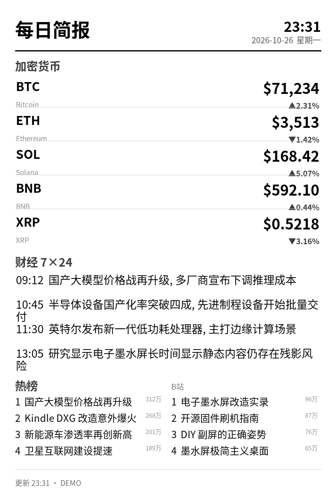
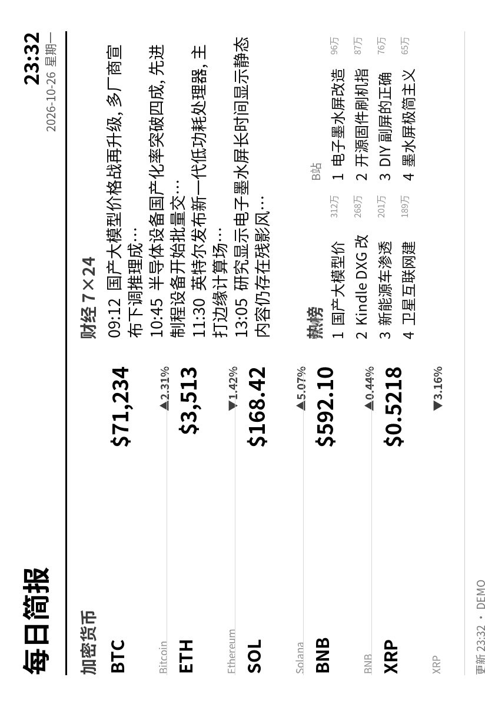

# 📟 KindleDXG-Bar

> **Your Kindle DXG, reborn as an always-on e-ink dashboard.**
> 加密货币行情 · 24 小时价格曲线 · 财经 7×24 快讯 · 全网热榜 —— 由路由器全自主驱动，Mac 可以下班了。

[](LICENSE)
[](#-quick-start-快速开始)
[](#-quick-start-快速开始)
[](#-router-side-路由器侧)

| 竖版（正常竖持） | 横版（顺时针横持） |
|:---:|:---:|
|  |  |

**无云端依赖 · 无常驻 Mac · 无额外硬件**：Kindle 插在路由器的 USB 口上，路由器每 15 分钟自己抓数据、渲染成墨水屏友好的灰度图、推到 Kindle 屏幕。

## 📚 Contents

- [📖 这是什么](#-这是什么)
- [✨ 功能一览](#-功能一览)
- [🚀 Quick Start 快速开始](#-quick-start-快速开始)
- [🔌 Kindle 侧：越狱与 usbnet](#-kindle-侧越狱与-usbnet)
- [📡 Router 侧：路由器部署](#-router-侧路由器部署)
- [🧩 软件中心插件（梅林）](#-软件中心插件梅林)
- [💻 Mac 直连调试模式](#-mac-直连调试模式)
- [⚙️ 配置说明](#️-配置说明)
- [🌐 数据源实测](#-数据源实测)
- [🩹 自愈机制](#-自愈机制)
- [🔬 工作原理](#-工作原理)
- [📝 更新历史](#-更新历史)
- [⚠️ 已知限制](#️-已知限制)
- [🙏 Credits](#-credits)
- [⚖️ License](#️-license)

## 📖 这是什么

把吃灰的 **Kindle DX / DXG**（9.7 寸墨水屏）变成一块挂在路由器上的信息副屏：

- **渲染在路由器端完成**：Python + Pillow 生成 824×1200 灰度图，通过 `eips` 刷到墨水屏
- **数据源可配置**：加密货币（Binance / CoinGecko / Gate.io 三源可混用）、财经快讯（新浪 7×24 / 华尔街见闻 / 金十 / 东方财富 / RSS）、热榜（微博 / 头条 / 知乎 / B站 / 百度 / 抖音 六选二）
- **一个可选项都没有的架构**：不依赖任何云服务、不需要 Mac 常驻、不需要额外供电设备——Kindle 的 USB 线同时解决供电与数据

## ✨ 功能一览

| Feature | Notes |
|---|---|
| 🖥️ 竖版 / 横版 | 横版内容旋转 90° 塞进竖屏 framebuffer，Kindle 顺时针横持观看 |
| ⏱️ 刷新频率可调 | 5~720 分钟；内容无变化时自动跳过刷屏，省墨水屏寿命 |
| 🪙 加密货币行情 | 固定 5 个交易对，价格 + 24h 涨跌 + **24h 价格曲线**（K 线抽稀 48 点） |
| 🔀 按币分源 | 某个币只有 Gate 有？给它单独指定来源，其余币走全局源 |
| 📰 财经快讯 | 5 个源可选 + RSS 池兜底，主源挂了自动切换 |
| 🔥 全网热榜 | 双栏并排，微博/头条/知乎/B站/百度/抖音 六选二 |
| 🧩 软件中心插件 | 梅林固件里网页配置一切：方向/频率/顺序/币种/来源/条数 |
| 🔍 交易对一键检测 | 输入代码实测三个行情源是否可用，✓/✗ 直观展示 |
| 🩹 三层自愈 | USB 重插、Kindle 重启、网络抖动都能在下一个周期自动恢复 |

## 🚀 Quick Start 快速开始

**硬件要求**：Kindle DXG（已越狱，FW 3.2.1 "Frankenstein" 实测可用）· 一台带 USB 口的路由器（梅林固件最佳，OpenWrt / 树莓派脚本也备好了）· micro-USB 数据线 · 一个 U 盘（装 Entware，需 ext2/3/4 分区）。

### 路线 A：梅林软件中心插件（推荐，最傻瓜化）🧩

1. Kindle 越狱装 usbnet（FC02 老格式包），插到路由器 USB 口
2. U 盘格式化为 ext4（amtm 或软件中心『USB 应用』，一次性，会清空数据），插到路由器另一个 USB 口
3. 把 `koolshare/kindledash/` 打包成 `kindledash.tar.gz`，软件中心离线安装 **Kindle仪表盘**
4. 打开插件页 → **环境自检** → 缺什么点 **一键安装依赖**（自动装 Entware / Python3 / Pillow / 下载字体 / 注册定时任务）
5. 全部 ✓ 后点 **保存并应用**，Kindle 亮屏 🎉

> 渲染程序、默认配置、开机脚本全部随插件打包，装完即用；之后的所有调整都在网页里完成。

### 路线 B：SSH 手工部署

```bash
# 1. Kindle 侧 —— 越狱后安装 usbnet(FC02 老格式包), 然后把 Kindle 插上路由器 USB 口
#    (Kindle 侧一次性配置, 详见下文)

# 2. 路由器侧 —— SSH 进路由器, 装 Entware + 依赖
opkg install python3
/opt/bin/pip3 install Pillow

# 3. 把本仓库部署到路由器
mkdir -p /opt/kindle-dash/fonts
#    上传 dashboard.py / push.sh / run.sh / config.json 到 /opt/kindle-dash/
#    上传字体到 /opt/kindle-dash/fonts/ (见 fonts/README.md)

# 4. 跑一次看效果, 然后注册 cron
sh /opt/kindle-dash/run.sh
cru a kindle-dash "*/15 * * * * /bin/sh /opt/kindle-dash/run.sh >> /opt/kindle-dash/run.log 2>&1"
```

详细步骤、踩坑与可选组件往下看 👇

## 🔌 Kindle 侧：越狱与 usbnet

1. **越狱**：DXG 在 FW 3.2.1（社区 "Frankenstein" 固件）上可越狱。越狱方法参考 MobileRead 论坛的 DXG 板块。
2. **安装 usbnet**：用 **FC02 老格式**的 usbnet 0.57.N 包（SP01/FD04 新格式包老固件不认）。装好后 Kindle 的 USB 网卡是 RNDIS/CDC-ECM gadget，IP 默认 `192.168.2.2`。
3. **`kindle/setup_kindle.sh`**：SSH 进 Kindle（usbnet 模式下 root，密码留空或任意）后执行，它会：
   - 建 `/mnt/us/dash` 工作目录并校时
   - 进入**信息亭模式**：停掉 framework / powerd / netwatchd，让 `eips` 独占屏幕
   - 立刻刷一张图验证链路

> 💡 实测细节：dropbear 在 usbnet 模式下**不校验密码**（服务端设计如此），这反而是自动化推送的便利——后续脚本用空密码直连。

## 📡 Router 侧：路由器部署

`router/` 目录按你的设备对号入座：

| 脚本 | 适用 | 作用 |
|---|---|---|
| `usbnet-up.sh` | Asuswrt-Merlin | 加载 rndis_host/cdc_ether，给 usb0 配 `192.168.2.1/24` |
| `kindle-dash-start.sh` | 梅林 | 开机自启：配 usb0 + 注册 cron（幂等） |
| `services-start.snippet.sh` | 梅林 | 追加到 `/jffs/scripts/services-start` 的调用片段 |
| `watchdog.sh` | 通用 | usb0 掉线自愈看门狗（可选，run.sh 本身已含自愈） |
| `openwrt-usbnet.sh` | OpenWrt / GL.iNet | 复用手机 tethering 驱动接入 Kindle |
| `pi-usbnet.sh` | Raspberry Pi | Zero W / 4B 等桥接方案（没有空闲路由器 USB 口时的选择） |

**推荐部署布局**（Entware 装在 U 盘上）：

```
/opt/kindle-dash/
├── dashboard.py      # 渲染器
├── config.json       # 你的配置 (从 config.example.json 复制)
├── push.sh           # 推送: HTTP 拉取 + md5 校验 + eips 刷屏
├── run.sh            # cron 入口: 自愈 usb0 → 渲染 → 推送 → 写缓存
├── fonts/*.otf       # 思源黑体 (见 fonts/README.md)
└── cache.json        # 最近一次数据 (源挂了时离线兜底渲染)
```

## 🧩 软件中心插件（梅林）

不想手改配置？`koolshare/kindledash/` 是一个标准的 koolshare 离线插件包：

1. 把 `koolshare/kindledash/` 打包成 `kindledash.tar.gz` 上传到软件中心离线安装
2. **运行环境**面板：环境自检（8 项依赖体检）+ 一键安装依赖（Entware/Python/Pillow/字体/定时任务全自动）
3. 在软件中心点开 **Kindle仪表盘**，网页里改：屏幕方向、刷新频率、模块顺序、行情源、**手动添加代币 + 一键检测交易对**、快讯源、RSS 订阅池（可开**渠道轮播**）、热榜双栏……
4. 「保存并应用」= 写配置 → 重注册 cron → 立即渲染推送一轮，过程日志页面里实时可看
5. **配置备份**：一键导出全部配置为文本（可存到别处），换路由器/重装插件后粘贴导入即恢复

## 💻 Mac 直连调试模式

开发调试时可以把 Kindle 插 Mac（不需要路由器参与）：

```bash
# macOS 原生自带 RNDIS 驱动, 给网卡配个 IP 即可:
networksetup -setmanual "RNDIS/Ethernet Gadget" 192.168.2.1 255.255.255.0
ssh root@192.168.2.2          # 直接进 Kindle
python3 dashboard.py          # 本机渲染预览
sh push.sh                    # 推送到 Kindle (Mac 模式: OpenSSH + 密钥)
```

`push.sh` 自动识别环境：有 `dbclient` 走路由器模式，否则走 Mac 的 OpenSSH 密钥模式。

## ⚙️ 配置说明

复制 `config.example.json` 为 `config.json`，所有字段见模板内注释。核心字段：

| 字段 | 默认 | 说明 |
|---|---|---|
| `orientation` | `portrait` | `landscape` = 横持模式 |
| `refresh_minutes` | `15` | 刷新周期（分钟），建议 15~30 |
| `modules` | 全开 | 显示顺序 = 数组顺序 |
| `crypto.source` | `binance` | 全局行情源（binance 走官方镜像 `data-api.binance.vision`，国内直连） |
| `crypto.pairs` | BTC/ETH/SOL/BNB/XRP | 最多 5 个，顺序即显示顺序，支持任意 USDT 交易对代码 |
| `crypto.pair_sources` | `{}` | 按币覆盖来源，如 `{"PEPE": "gate"}` |
| `fastnews.source` | `sina7x24` | `sina7x24` / `wallstcn` / `jin10` / `eastmoney` / `rss` |
| `hot[].source` | 微博+B站 | `weibo` / `toutiao` / `zhihu` / `bilibili` / `baidu` / `douyin` |

## 🌐 数据源实测

全部在路由器真实网络环境下验证（2026-10）：

| 类别 | ✅ 可用 | ❌ 不可用（实测被墙/接口失效） |
|---|---|---|
| 行情 | Binance 镜像、Gate.io、CoinGecko（需代理） | OKX |
| 快讯 | 新浪 7×24、华尔街见闻、金十、东方财富、RSS 池 | — |
| 热榜 | 微博、头条、知乎(v2)、B站、百度、抖音 | 小红书（x-s 签名墙） |
| RSS | 36氪、IT之家、少数派、Solidot、新浪财经、Cointelegraph、ForesightNews | 虎嗅、cnBeta、金色财经、律动、Odaily |

> 💡 **为什么行情默认走 `data-api.binance.vision`**：它是 Binance 官方公共行情镜像，数据格式与 `api.binance.com` 完全一致，但国内**直连可达**——不需要代理，路由器裸网环境也能跑。

## 🩹 自愈机制

| 场景 | 恢复方式 |
|---|---|
| Kindle 线拔掉重插 | 下一轮 `run.sh` 自动重新配 usb0 IP 并恢复推送（≤1 个周期） |
| Kindle 整机重启 | 每轮推送前重新停止 framework/powerd（kiosk 自愈），第一轮推送即回到全屏仪表盘 |
| 数据源挂了 | 自动切换到同币种的其他行情源；全挂则用 `cache.json` 离线渲染（标注"数据可能过期"） |
| 内容没变化 | 逐字节比对后跳过传输与刷屏，省墨水屏寿命 |

## 🔬 工作原理

```
┌─────────────── 路由器 ───────────────┐         ┌── Kindle DXG ──┐
│ cron (每 N 分钟)                      │         │ usbnet gadget  │
│   └► run.sh                          │  USB    │  192.168.2.2   │
│       ├─ 自愈: usb0 配 192.168.2.1    ├─usb0───►│  dropbear ssh  │
│       ├─ dashboard.py 抓数据+渲染      │         │  eips 刷屏     │
│       ├─ 临时 HTTP 服务 (8123)        │◄────────┤  busybox wget  │
│       │   └─ Kindle wget 拉图 +md5校验 │  HTTP   │  (拉取镜像)    │
│       └─ eips -f -g 刷到墨水屏        ├────────►│                │
└──────────────────────────────────────┘  SSH命令 └────────────────┘
```

一个值得记录的坑：**dropbear 的 `dbclient` 管道直传文件会稳定丢失第一个 4096 字节缓冲**（垫片/sleep/dd 均无效）。所以传输改为「路由器临时起 HTTP 服务 → Kindle 自带 `busybox wget` 拉取 → 远端 md5 校验通过才落盘刷屏」，`dbclient` 只用作命令通道。

## 📝 更新历史

| 版本 | 日期 | 更新 |
|---|---|---|
| v1.2.1 | 2026-10-27 | 配置导入/导出；快讯渠道轮播（新资讯不足自动轮到下一渠道）；热榜去热度值全宽两行显示；横版行情对齐重构 |
| v1.2.0 | 2026-10-27 | 插件页『运行环境』面板：环境自检 8 项体检 + 一键安装依赖（Entware/Python/Pillow/字体/定时任务全自动）；渲染程序随插件打包，装完即用 |
| v1.1.2 | 2026-10-27 | 修复自定义币被渲染器内置币池静默过滤的问题 |
| v1.1.1 | 2026-10-27 | 支持按币种指定行情来源（`pair_sources`），曲线按币选 K 线端点 |
| v1.1.0 | 2026-10-26 | 横版渲染、模块排序、三行情源混用、5 快讯源 + 6 热榜源、koolshare 软件中心插件（含交易对一键检测、手动添加代币） |
| v1.0.0 | 2026-10-26 | 首个可用版本：路由器全自主渲染推送，HTTP 拉取传输，三层自愈 |

## ⚠️ 已知限制

- **需要越狱**：整套方案建立在 usbnet + SSH 之上，未越狱的 Kindle 无法使用
- **仅 DX/DXG 实测**：原理适用于所有带 `eips` 的 Kindle，但分辨率（824×1200）与按键布局按 DXG 调的
- **热榜依赖反爬接口**：微博/知乎等非官方接口可能随时变化，源挂掉时该栏自动留空，不影响其他模块
- **墨水屏寿命**：已做内容去重 + 离线缓存兜底，但 5 分钟级高频刷新仍会加速老化，日常建议 15 分钟以上

## 🙏 Credits

- [KindleTool / MR 论坛](https://www.mobileread.com/forums/forumdisplay.php?f=150) 的越狱与 usbnet 工具链
- [Entware](https://github.com/Entware/Entware) 与 koolshare 梅林软件中心框架
- 数据来自 Binance / Gate.io / CoinGecko / 新浪财经 / 金十 / 东方财富 / 微博 / 知乎 / B站 / 百度 / 抖音 的公开接口

## ⚖️ License

[MIT](LICENSE) — 数据归各来源平台所有，请遵守其服务条款；刷机与越狱风险自负。
